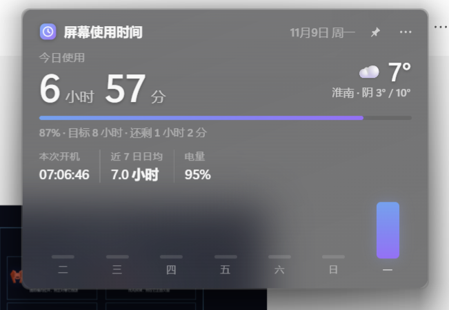
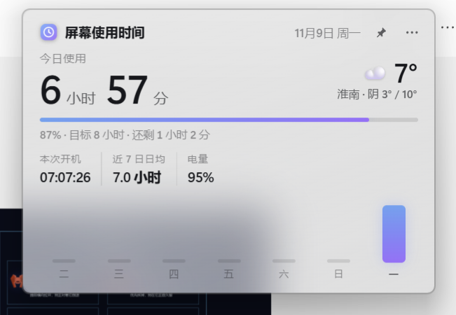
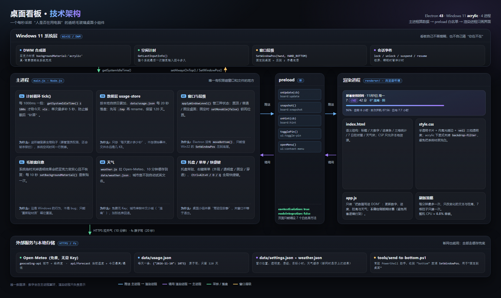

# 桌面看板 · 屏幕使用时间

**一个常驻桌面的「屏幕使用时间」小组件**：透明毛玻璃、Windows 11 系统级亚克力模糊、大圆角、无边框，
形态参考 macOS 的桌面小组件。打开就能看到今天用了多久电脑、离每日目标还差多少，右上角还带当天天气。


| 深色玻璃 | 浅色玻璃 |
| --- | --- |
|  |  |

> 截图来自真实桌面：深色玻璃叠在 Windows「Mountain」壁纸上，浅色玻璃叠在浏览器窗口上。
> 更多图见 [`assets/architecture.png`](assets/architecture.png)（技术架构）与文末的架构图章节。

---

## 一、安装与启动

### 1. 准备

- Windows 11 **22H2 或更新**（系统亚克力材质的要求；Win10 只能用 `--glass=css` 的降级实现）
- [Node.js](https://nodejs.org/) 18+ 、[pnpm](https://pnpm.io/)（`npm i -g pnpm`；用 npm 也行）

```powershell
git clone https://github.com/Moun-xz/desktop-usage-board.git
cd desktop-usage-board
pnpm install
```

> 国内网络下 Electron 二进制容易下载失败，先设镜像再装：
>
> ```powershell
> $env:ELECTRON_MIRROR = "https://npmmirror.com/mirrors/electron/"
> pnpm install
> ```

### 2. 启动

| 方式 | 操作 |
| --- | --- |
| 静默启动（推荐） | 双击 **`start.vbs`**：不弹黑框。想放桌面就右键 →「发送到」→「桌面快捷方式」 |
| 想看启动日志 | 双击 **`start.cmd`**，出错会停在窗口里 |
| 开发调试 | `pnpm start`（等价于 `electron .`） |

启动后窗口出现在**屏幕右上角**，任务栏里没有图标（在系统托盘里：圆形渐变小图标）。
默认「窗口置顶」用的是毛玻璃颜色最正常的那一层；如果想连全屏视频也盖住，去菜单 →「外观」→
勾选「盖住全屏视频（毛玻璃会略暗）」（代价见下文）。嫌挡视线就按 `Ctrl + Alt + H` 收起。

**关闭 ≠ 退出**：点窗口右上角 `⋯` 或右键窗口，菜单里选「隐藏看板」只是收起来；
真正退出请用菜单里的「退出」、托盘右键「退出」，或按 `Ctrl+Alt+Q`。

---

## 二、界面读法

| 元素 | 含义 |
| --- | --- |
| 大数字 `6 小时 31 分` | **今日活跃使用时长**（人真的在用电脑的时间） |
| 紫色进度条 + `82% · 目标 8 小时 · 还剩 1 小时 28 分` | 今日使用量 / 每日目标的完成度 |
| `本次开机` | 这次开机到现在多久（系统运行时间，含睡眠） |
| `近 7 日日均` | 最近 7 天有记录日期的平均活跃时长 |
| `电量` | 笔记本电池电量（台式机没有电池时显示 `—`） |
| 底部柱状图 | 最近 7 天，最右边是今天（彩色）+ 下面加粗的星期几 |
| 右上角 `☁️ 7°` + `淮南 · 阴 3° / 10°` | **当天实时天气**：当前气温 + 城市·天气 + 今天最低/最高 |
| 时间显示 `11月9日 周一` | 今天的日期 |

鼠标悬停在柱子上可以看到那一整天的具体时长；首日的数据会标注「按开机时长估算」。
鼠标悬停在天气上可以看到体感温度和更新时间。

### 天气是怎么来的

- 数据源是 [Open-Meteo](https://open-meteo.com/) 的免费接口：不需要 API Key、不用注册，只查当前气温 + 当天高低温。
- 启动时拉一次，之后每 **10 分钟**刷新一次；断网或接口失败时**保留上一次的结果**，不会让界面闪空白。
- 默认城市是**北京**；要换城市就在 `data/settings.json` 里写 `"weather": { "city": "合肥" }`（或你所在的城市），重启看板生效。
  中文地名 Open-Meteo 有的能查到、有的查不到（比如「淮南」查不到），程序会自动再试英文名（`Huainan`）和去掉「市/县/区」的写法；
  实在查不到就把 city 写成拼音或附近的大城市（例如 `Hefei`）。
- 菜单 `⋯` →「天气」里可以临时关掉天气、或立刻刷新。

---

## 三、统计口径（重要，别被数字吓到）

**统计的是「活跃使用」，不是「开机时长」。**

- 每秒检查一次：如果过去 **3 分钟内**有键鼠输入，就记 1 秒；离开电脑、锁屏、合盖睡眠都不计时。
- 为什么不直接用系统开机时长？因为现代待机（S0ix）下 Windows 不写睡眠日志，
  `os.uptime()` 会把合盖整晚也算成「开机中」，一天能算出 24 小时，对「我今天用了多久」毫无参考价值。
- **安装/首次运行当天**：为了让数字不是 `0 分钟`，会用「本次已开机时长」给今天一个初始估算
  （柱状图 tooltip 会标「按开机时长估算」）。从第二天起，每天从 0 开始按真实活跃时间累加。

结论：头一天的数字偏大是正常的，第二天起就是真实活跃时长了。

---

## 四、交互与快捷键

| 操作 | 效果 |
| --- | --- |
| 拖动卡片空白处 | 移动位置（位置会被记住；固定到桌面后不能拖） |
| 拖边缘 | 缩放大小（最小 320×200，矮于 224px 会自动收起次要信息；固定到桌面后不能缩放） |
| 点右上角**图钉 📌** | 一键「固定到桌面」：一直在屏幕上、**不盖住**其它应用窗口，并且**锁住位置和大小**，不会被误拖动；图钉变蓝表示已固定，再点一下解锁 |
| 点 `⋯` / 右键窗口 | 弹出菜单：固定到桌面、窗口置顶、鼠标穿透、外观（配色 / 修复毛玻璃 / 盖住全屏）、透明度、天气、刷新、开机自启、隐藏、退出 |
| 托盘图标单击 | 显示 / 隐藏看板 |
| 托盘图标右键 | 同样的菜单（多一项「显示 / 隐藏看板」） |
| `Ctrl + Alt + H` | 显示 / 隐藏 |
| `Ctrl + Alt + D` | 鼠标穿透开关 |
| `Ctrl + Alt + Q` | 退出 |

「开机自动启动」勾选后，会在 Windows 的启动目录里写一个 `桌面看板.lnk` 快捷方式（不动注册表，取消勾选即删除）。

### 三种「层级」怎么选

| 模式 | 行为 | 适合 |
| --- | --- | --- |
| **窗口置顶**（默认） | 永远在最上面 | 想随时看到数字 |
| **固定到桌面** | 待在桌面层，任何应用窗口打开都会盖住它，点一下它也不会赖在最上面；**位置和大小被锁住** | 当桌面装饰 / 不想被挡到 / 不想被误拖动 |
| 都不勾 | 普通窗口，正常叠放 | 临时用 |

**置顶还想盖住全屏播放器？** 默认置顶是 `normal` 层（毛玻璃颜色最正常），全屏独占的视频/游戏可能压得住它。
想要「连全屏播放器都盖住」，去菜单 →「外观」→ 勾选「**盖住全屏视频（毛玻璃会略暗）**」——
代价是这一层会让亚克力明显发灰发暗（Windows 对该层的处理），鱼与熊掌按需取一个。

### 关于鼠标穿透（不会再把自己锁死）

开启穿透后窗口不接收鼠标点击，**但有三条路能关掉它**：

1. 按 `Ctrl + Alt + D`（全局快捷键，穿透时依然有效）
2. 右键**系统托盘**图标 → 取消「鼠标穿透」
3. 点托盘图标隐藏再显示（穿透状态会保留，但菜单一直可用）

开启的瞬间会弹一条 Windows 通知 + 卡片底部一条提示条告诉你快捷键；而且**穿透状态不会写入配置文件**，
所以就算什么都点不到，重启看板也会恢复正常。

### 透明度与配色

菜单 →「透明度」：**标准 / 更透明（默认）/ 最透明**。系统亚克力已经提供了真模糊，
卡片自身只叠一层很淡的纱；选「最透明」时几乎是纯系统材质，壁纸颜色会直接透上来。

菜单 →「外观」：**跟随系统 / 浅色玻璃 / 深色玻璃**。
下面还有两项：

- 「**盖住全屏视频（毛玻璃会略暗）**」：把置顶层级从 `normal` 换成 `screen-saver`。能盖住全屏播放器，
  但亚克力在这一层会明显发灰发暗（实测：同背景下 `normal` 层颜色饱和度 ≈193，`screen-saver` 层只有 ≈90）。
- 「**修复毛玻璃**」：万一卡片突然变成不透明实心（Windows 临时关掉透明效果导致），点一下立刻恢复。

- **浅色玻璃**：白色磨砂，和 macOS 浅色小组件一致；在白色窗口上会显得比较「奶」，
  这是 Windows 浅色亚克力本身的白纱造成的，不是样式写错了。
- **深色玻璃**：深色磨砂 + 白字，背景的光和颜色透上来最明显，**想「更透」就用这一档**。

> 之所以要「关掉 CSS 模糊」，是因为 acrylic 窗口里再叠 `backdrop-filter` 会把系统材质洗白变浑浊；
> 现在卡片只有一层极淡的纱，模糊完全交给系统的 DWM。

---

## 五、毛玻璃是怎么做出来的

窗口用 Electron 的无边框窗口，毛玻璃走 **Windows 11 系统材质**：

```js
new BrowserWindow({
  transparent: false,
  backgroundMaterial: 'acrylic', // DWM 实时模糊窗口背后的桌面
  frame: false, hasShadow: true, roundedCorners: true, skipTaskbar: true,
})
```

真正的模糊由 Windows 的 DWM 完成（比 CSS 的 `backdrop-filter` 更像 macOS），
窗口内部的 HTML/CSS 只负责一层很淡的白色/深色「纱」+ 高光描边，所以主题会跟随系统深浅色自动切换。

> 小坑：在 acrylic 窗口里再叠 CSS `backdrop-filter` 会把材质「洗白」变浑浊（看起来反而更不透明），
> 所以 `html[data-glass='acrylic'] .card` 里显式关掉了 `backdrop-filter`，让系统亚克力原样透上来。

可切换的实现方式（命令行参数）：

| 参数 | 说明 |
| --- | --- |
| `--glass=acrylic` | **默认**，Win11 亚克力，真模糊 |
| `--glass=mica` | Win11 云母，模糊更弱、更「静态」 |
| `--glass=css` | 半透明窗口 + CSS 模糊（老系统兜底，效果差一些） |
| `--theme=dark` / `--theme=light` | 强制深/浅色（默认跟随系统） |

---

## 六、文件结构

```
桌面看板/
├─ main.js                 主进程：窗口、托盘、菜单、计时、快捷键、开机自启
├─ preload.js              安全桥：向页面暴露 window.board
├─ package.json
├─ start.vbs / start.cmd    双击启动器（.vbs 无黑框，.cmd 有日志）
├─ renderer/
│  ├─ index.html           卡片结构
│  ├─ style.css            毛玻璃样式（浅色 / 深色 / acrylic 三套变量）
│  └─ app.js               把主进程推来的数据画成界面（不做计算）
├─ src/
│  ├─ settings.js          窗口位置、置顶、固定桌面、透明度、天气、goalHours
│  ├─ usage-store.js       按天累计秒数，data/usage.json 原子读写
│  ├─ weather.js           Open-Meteo 天气（城市名→经纬度→气温），带缓存
│  └─ desktop-pin.js       「固定到桌面」：把窗口压到 z 序最底层（调用下面的 ps1 助手）
├─ assets/                 icon.png / tray.png / preview*.png / architecture.png
├─ docs/
│  └─ architecture.html    技术架构图（可直接用浏览器打开，改完重新导出）
├─ tools/
│  ├─ gen-icons.py         Pillow 生成图标（4 倍超采样）
│  ├─ send-to-bottom.ps1   user32.SetWindowPos(HWND_BOTTOM) 的常驻小助手
│  ├─ deskshot.js          整屏截图（能拍到 acrylic 窗口，用于验收）
│  └─ render-diagram.js    把 docs/architecture.html 渲染成 assets/architecture.png
├─ .gitattributes          强制 .cmd/.vbs/.ps1 用 CRLF（否则 Windows 脚本会失效）
└─ data/                   ← 运行时生成，已加入 .gitignore
   ├─ settings.json        窗口位置 + 偏好设置（含天气城市）
   ├─ usage.json           每天累计的活跃秒数
   └─ weather.json         天气缓存（断网时用它顶着）
```

---

## 七、想改点什么

| 想改 | 改哪里 |
| --- | --- |
| 每日目标 8 小时 | `data/settings.json` 里 `"goalHours": 8`，重启生效 |
| 天气城市 / 关掉天气 | `data/settings.json` 里 `"weather": { "enabled": true, "city": "北京" }`（默认北京，改成你所在城市），重启生效 |
| 默认透明度 | `data/settings.json` 里 `"veil"`：`normal` / `clear` / `ultra` |
| 默认配色 | `data/settings.json` 里 `"theme"`：`system` / `light` / `dark` |
| 启动时默认固定到桌面 | `data/settings.json` 里 `"pinToDesktop": true` |
| 置顶层级（毛玻璃发暗就改它） | `data/settings.json` 里 `"topLevel"`：`normal`（默认，颜色正常）/ `screen-saver`（盖全屏但发暗） |
| 离开多久算不在（默认 3 分钟） | `main.js` 顶部 `IDLE_LIMIT_SECONDS` |
| 配色 / 圆角 / 字号 | `renderer/style.css` 顶部的 CSS 变量 |
| 窗口默认大小位置 | `main.js` 的 `defaultBounds()` |
| 看板内容（加指标等） | `main.js` 的 `buildBoard()` + `renderer/app.js` 的 `render()` |

---

## 八、常见问题

**Q：启动后找不到窗口？**
按 `Ctrl + Alt + H`，或点系统托盘里的渐变圆形图标；也可能是被拖到屏幕外了，
删掉 `data/settings.json` 再启动就会回到右上角默认位置。

**Q：在 DSH / 终端里 `pnpm start` 报 `Cannot read properties of undefined (reading 'requestSingleInstanceLock')`？**
那个终端里有 `ELECTRON_RUN_AS_NODE=1`，Electron 会退化成普通 Node 运行。先执行：

```powershell
$env:ELECTRON_RUN_AS_NODE = $null
```

再 `pnpm start`；或者直接用 `start.vbs`。

**Q：重装依赖后 `node_modules\electron\dist` 是空的？**
pnpm 11 默认拦截构建脚本。本项目已在 `package.json` 里声明 `pnpm.onlyBuiltDependencies: ["electron"]`，
执行 `pnpm install` 后再补一次二进制下载（国内建议走镜像）：

```powershell
$env:ELECTRON_MIRROR = "https://npmmirror.com/mirrors/electron/"
node node_modules/electron/install.js
```

**Q：数字一直是 0？**
只有在「3 分钟内有输入」时才计时，纯挂机不动不会增长；另外检查系统时间/日期是否正确。

**Q：用着用着毛玻璃突然没了，变成一整块不透明的深灰？**

先分两种情况：

1. **置顶模式下一直发暗/发灰**：那是 `screen-saver` 置顶层干的（Windows 会让这一层的亚克力变灰）。
   去菜单 →「外观」→ **取消勾选「盖住全屏视频**」，玻璃立刻恢复鲜活；代价是盖不住全屏播放器。
2. **本来好好的、突然变实心**：是 Windows 的「透明效果」被临时关掉了（**省电模式**、
   播放器/游戏等**全屏独占程序**、切换**电源模式**都会触发），已经开着的亚克力窗口会被降级成实心色，
   而且**系统重新打开透明效果之后也不会自动恢复**。看板的处理方式：

   - 程序每 10 秒会自己重新贴一次材质，所以最多 10 秒内会自己恢复（前提是系统透明效果已经回来了）；
   - 窗口重新出现、被点到、从睡眠/锁屏回来时，也会立刻补一刀；
   - 想手动立刻修好：右键 →「外观」→「**修复毛玻璃（变实心时点一下）**」；
   - 如果系统里「透明效果」本身是关的（设置 → 个性化 → 颜色 → 透明效果），那它就应该是不透明的。

**Q：想看它真实的样子并截图存档？**

```powershell
$env:ELECTRON_RUN_AS_NODE = $null
node_modules\electron\dist\electron.exe tools\deskshot.js shot.png
```

（普通 BitBlt 截图拍不到 acrylic 窗口，这个脚本走 Electron 桌面捕获，能拍到。）

**Q：它占多少内存 / CPU？**

实测（本机，Electron 43，4 个进程）：

| 指标 | 数值 | 说明 |
| --- | --- | --- |
| 内存（工作集） | 约 220–340 MB | Chromium 多进程的基线，含 GPU 进程 |
| 内存（私有） | 约 170–310 MB | 任务管理器里「内存」那列看的接近这个 |
| CPU | 约 0.5% 单核（≈ 整机 0.02%） | 界面**每分钟才刷新一次**，数字本来也只显示到分钟 |

如果想让内存再小一个量级，只能换外壳（Tauri / WebView2，约 40–80 MB），
代价是失去 Windows 原生 acrylic 这种系统级毛玻璃。

---

## 九、可以继续加的东西

- 目标达成时弹一个小提示 / 换一种强调色
- 周报：把 `data/usage.json` 按周汇总成一张卡片
- 分应用统计（读 `UserAssist` 注册表或用 Win32 API 采样前台窗口）
- 打包成 exe（`electron-builder`），免去 Node 环境
- 天气再扩展：未来 2 天预报 / 下雨提醒（Open-Meteo 接口已经支持，只是卡片位置有限）

---

## 十、技术架构图



一张图看懂四层分工：

| 层 | 干什么 | 关键点 |
| --- | --- | --- |
| Windows 系统层 | 提供 DWM 亚克力模糊、系统空闲时间、窗口层级、锁屏/睡眠事件 | 看板自己不画模糊，也不自己猜“人在不在” |
| 主进程 main.js | 计时、存盘、窗口层级、毛玻璃自愈、天气、托盘菜单 | **唯一数据源**，所有数字先在这里算好 |
| preload.js | `contextBridge` 白名单，7 个方法 | 页面拿不到 Node，只能通过它说话 |
| 渲染进程 renderer/ | 把 payload 写进 DOM | 不做任何计算，避免两套逻辑打架 |

图有两个版本：

- `assets/architecture.png` —— 导出的高清图（2550×1517）
- `docs/architecture.html` —— 可编辑的源文件，改完重新导出：

```powershell
$env:ELECTRON_RUN_AS_NODE = $null
node_modules\electron\dist\electron.exe tools\render-diagram.js
```

（用 Electron 自己的离屏窗口渲染，字体/圆角/阴影和网页里完全一致，还自带系统 dpr 的高清输出。）

---

## 十一、隐私与许可

- **本地优先**：使用时长、窗口位置、设置全部只写在项目内的 `data/` 目录（已加入 `.gitignore`），
  不会上传、没有账号、没有埋点。
- **联网只做一件事**：每 10 分钟向 [Open-Meteo](https://open-meteo.com/) 发一次城市名与气温查询（不需要 API Key）；
  不想要网络请求就把 `data/settings.json` 里的 `"weather": { "enabled": false }` 关掉。
- **许可**：[MIT](LICENSE) —— 随便用、随便改，保留版权声明即可。

## 十二、已知限制

- 只有 Windows 11 22H2+ 才有系统级 acrylic；更老的系统请用 `pnpm run start:css`（CSS 模糊，效果差一档）。
- 只在「看板运行时」计时：开机后没启动看板的那段时间不会被补记。
- 连续 3 分钟没有键鼠输入就停止计时（看视频、挂机下载都算「不在」），这是为了贴近「真的在用」。
- 首日数字是估算值（详见「三、统计口径」）。
